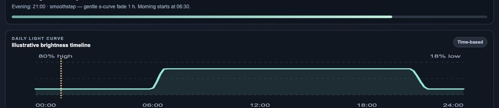

# PanelComfort

Automatically dim a rooted LG webOS TV in the evening and brighten it during the day.

## Features

- **Automatic backlight.** Fade the panel on a clock schedule, follow the sun, or use a room-light sensor.
- **Separate Eye Comfort controls.** Set its own hours, use a lux threshold, or switch it on or off.
- **Movie Mode.** Use a temporary brightness target and return to the schedule when you’re done.
- **HyperHDR and Home Assistant.** Adjust ambient LEDs with the TV and expose settings and status in Home Assistant.

## Install

1. On the TV, open **Homebrew Channel → Settings → Add repository** and enter the [Homebrew catalog URL](https://raw.githubusercontent.com/vibribbonee/arcguard/main/repo.json). Install **PanelComfort**, or download the [IPK from Releases](https://github.com/vibribbonee/panelcomfort-webos/releases/latest).
2. Open PanelComfort and install its service when prompted. Choose a schedule and select **Save & apply**.
3. For Home Assistant control, enable **Home Assistant API** on the TV and install the integration with the button above. Restart Home Assistant and accept discovery, or add **PanelComfort** with the TV’s address and port `8765`.

Tested on LG UP78 (43UP78006LB), webOS 6.3.2-425.

## Use it

- Use **Ambient LEDs → Connection settings** to test HyperHDR and select your instances.
- Use **Movie Mode** for a temporary brightness override.

Enable the Home Assistant API or optional browser dashboard on a trusted local network. Both allow control without a login.

[Settings and troubleshooting](docs/settings.md) · [Release notes](https://github.com/vibribbonee/panelcomfort-webos/releases/latest)

## Contributing

Pull requests are welcome. Describe the change and how you tested it.

[MIT license](LICENSE). OpenAI Codex assisted with development, testing, and documentation.
